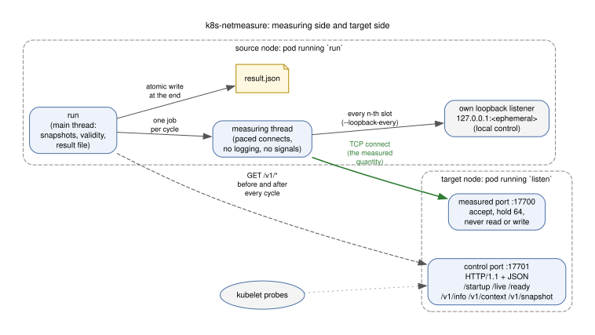
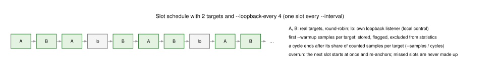
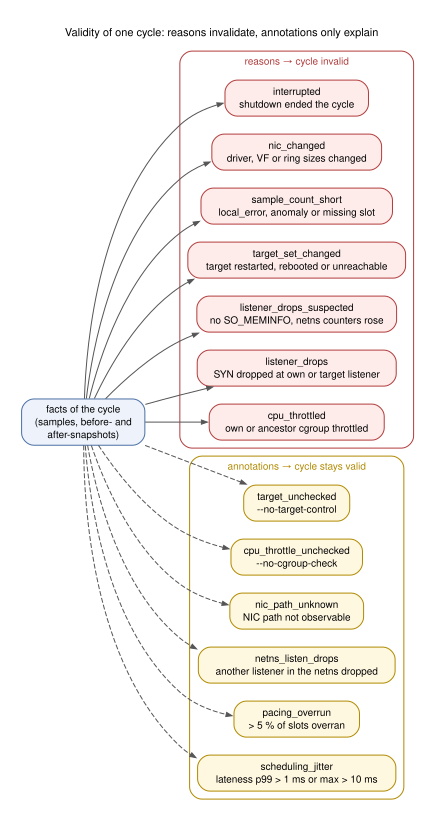

# Concepts

[User guide](README.md) · next: [`selftest` and `probe`](02-selftest-and-probe.md)

## What is measured

The time a TCP connection takes to be established: from `connect()` until the
three-way handshake has completed, measured on the client with a monotonic clock. No
data is sent. One measurement of one connection is a **sample**.

A sample has an **outcome**:

| Outcome | Meaning | Counted in the latency distribution? |
|---|---|---|
| `ok` | handshake completed | yes |
| `timeout` | no answer within `--timeout` (default 5 s) | yes, as "at least the timeout" |
| `refused` | the target answered with RST (nothing listens) | no, counted as a failure |
| `net_error` | network error, e.g. unreachable | no, counted as a failure |
| `local_error` | a resource of the measuring host ran out (file descriptors, ports, memory) | no; not a network result, the cycle becomes invalid |
| `anomaly` | the kernel reported success, but the socket is not connected | no; should never happen, the cycle becomes invalid |

A connection the target closed before it could be checked is still `ok` and is
flagged `peer_closed`.

SYN retransmissions are recorded per sample. A lost SYN costs about one second, so
a single retransmission dominates the tail of the distribution; the field tells you
whether a slow sample was a lost packet or a slow path.

## The two sides

- **`listen`** runs on the **target** node. It accepts connections on the measured
  port and never reads or writes on them. Its control port tells `run` who it is
  (`listener_instance`, a new ID on every start), on which node (`boot_id`, kernel,
  CPU, NIC) and what happened (accepted connections, dropped SYNs).
- **`run`** runs on the **source** node. It connects to every target in turn, at a
  fixed pace, and writes one result file.

## Paths: overlay and underlay

| Path | `run` runs in | Connects to | Measures |
|---|---|---|---|
| **overlay** | a normal pod | a `listen` pod's IP | the pod network (CNI, encapsulation) plus everything below |
| **underlay** | a `hostNetwork` pod | a `listen` with `hostNetwork`, at the node IP | the node network: NIC, driver, hypervisor, fabric |

Measuring both separates CNI effects from NIC effects. `run` records the path:
declared with `--path`, otherwise detected (physical interfaces visible → underlay).

## Pacing, round-robin and the loopback control

- One connect starts every `--interval` (default 10 ms), start to start. Pacing is
  independent of how long a connect takes, so a slow target does not change the
  sampling of the others.
- Targets take turns. Every `--loopback-every`-th slot (default 10) goes to a
  listener on `127.0.0.1` inside the `run` process. This **loopback control**
  measures the local machine only; if it shifts between two runs, the cause is local
  (CPU, kernel), not the network.
- The first `--warmup` samples per target (default 50) are stored but excluded from
  statistics.
- If a connect takes longer than the interval, the next one starts at once and the
  schedule continues from there; missed slots are never made up.

## Cycles and validity

The run is cut into **cycles** (default 10, each between 2 s and 60 s). Before and
after each cycle `run` reads counters on both sides. A cycle in which something
disturbed the measurement is marked **invalid**; its samples stay in the file, and
`report` (follows) leaves invalid cycles out.

Why per cycle: a disturbance (a CPU throttle, a full accept queue, a restarted
target, a NIC swapped by host maintenance) usually lasts seconds. Dropping one cycle
of ten loses 10 % of the data, not the whole run.

The NIC path is part of every cycle check because the same instance type can run on
hosts with different NIC hardware, and a virtual function can disappear and come
back during host maintenance. The NIC family is always observed, never derived from
the instance type.
