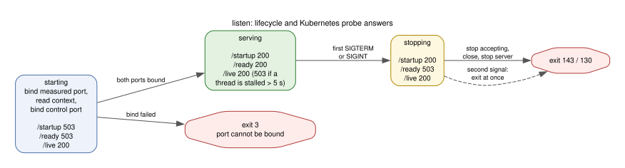

# `listen`: the measurement target

[User guide](README.md) · previous: [`selftest` and `probe`](02-selftest-and-probe.md) · next: [`run`](04-run.md)

> [!WARNING]
> **Minimal protection only, never expose it to the internet.** No authentication,
> no TLS, no rate limit. See [Security](05-kubernetes-openshift.md#security).

```sh
k8s-netmeasure listen [--port 17700] [--bind 0.0.0.0] [--backlog 4096] \
                      [--control-port 17701] [--control-bind auto] \
                      [--node-name N] [--zone Z] [--instance-type T] \
                      [--node-context-from <node-ip>:17701]
```

| Flag | Default | Meaning |
|---|---|---|
| `--port`, `--bind` | `17700`, `0.0.0.0` | measured port: accepts connections, never reads or writes |
| `--backlog` | `4096` | `listen()` backlog; the effective value is `min(backlog, net.core.somaxconn)` and is logged |
| `--control-port` | `17701` | HTTP control port; must differ from `--port` |
| `--control-bind` | `auto` | `auto` = the IPv4 address of the default-route interface (pod IP, or node IP with `hostNetwork`); `127.0.0.1` is then not served |
| `--node-name` | `$NODE_NAME` | declared node name; `run` uses it as the target's name |
| `--zone`, `--instance-type` | unknown | declared context; never used to infer the NIC family |
| `--node-context-from` | none | control port of the node listener (a `listen` with `hostNetwork` on the same node); its NIC path is reported instead of the pod's own (`unknown`). Must be on the same node and see a NIC, else exit 3 |

`listen` keeps the last 64 accepted connections open instead of closing each at
once, so its FIN cannot reach the client before the client has checked the
connection.

## Control port

| Request | Answer |
|---|---|
| `GET /startup` | 200 once both ports are bound and the context is read; 503 before |
| `GET /live` | 200 unless the accept or main thread is stalled for more than 5 s; never depends on the network |
| `GET /ready` | 200 while accepting; 503 before startup and from the first SIGTERM/SIGINT on |
| `GET /v1/info` | build, `listener_instance` (new ID per start), measured address, backlog |
| `GET /v1/context` | node context; every field as `{"value": …, "source": "observed" \| "declared" \| "unknown"}` |
| `GET /v1/snapshot` | counters: accepted/aborted/failed accepts, dropped SYNs, namespace drop counters, CPU throttling, NIC path |

An unknown path is 404, any method other than `GET` 405, any query string 400.

```sh
curl -s http://10.0.0.5:17701/v1/context | jq '.nic'
```

In a normal pod `nic` is `unknown`: a pod's network namespace has no physical
interface. With `hostNetwork` it lists every physical interface with driver and
ring sizes. With `--node-context-from` an overlay `listen` reports the node
listener's NIC path (refreshed every second), marked `observed_via_node_listener`;
if the node listener stops answering, `nic` is `unknown` until it answers again.

## Lifecycle



On SIGTERM `/ready` turns 503 at once, so Kubernetes stops routing to the pod; then
`listen` stops accepting, closes and exits with 143 (130 for SIGINT). A second
signal exits at once. A port that cannot be bound is exit 3.
