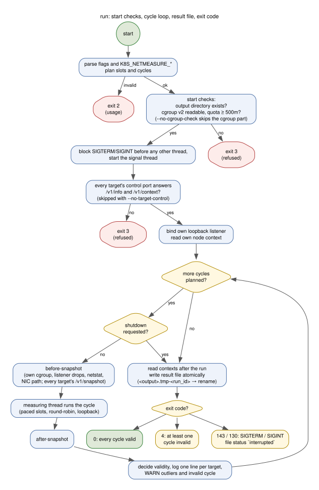

# `run`: the measurement

[User guide](README.md) · previous: [`listen`](03-listen.md) · next: [Running in Kubernetes and OpenShift](05-kubernetes-openshift.md)

```sh
k8s-netmeasure run --target 10.0.0.5:17700 [--target 10.0.0.6:17700 ...] --output results/ \
    [--samples 5000] [--warmup 50] [--interval 10ms] [--loopback-every 10] \
    [--cycles 10 | --cycle 20s] [--timeout 5s] [--outlier-threshold 20ms] \
    [--path overlay|underlay] [--label k=v ...] [--backlog 4096] \
    [--target-control-port 17701 | --no-target-control] [--no-cgroup-check] \
    [--shutdown-deadline 10s] [--control-port 17702 [--control-bind auto]] \
    [--node-name N] [--zone Z] [--instance-type T] [--node-context-from <node-ip>:17701]
```



## Parameters

| Flag | Default | Meaning |
|---|---|---|
| `--target` | required | `IPv4:port`, repeatable (env: comma-separated). One target is `pair` topology, several `sampled` |
| `--samples` | 5000 | counted samples per target after warm-up; 5000 gives about 50 samples above the p99 |
| `--warmup` | 50 | first samples per target, stored but excluded |
| `--interval` | 10ms | start-to-start spacing of connects |
| `--loopback-every` | 10 | every n-th slot measures the own loopback control |
| `--cycles` / `--cycle` | 10 | number of cycles, or a fixed cycle length; kept between 2 s and 60 s |
| `--timeout` | 5s | per connect; must cover several SYN retransmissions (1 s, 3 s, …) |
| `--outlier-threshold` | 20ms | slower samples are logged at WARN after their cycle |
| `--path` | detected | `overlay` or `underlay`; detected from visible physical interfaces |
| `--label k=v` | none | free labels for the file and logs, e.g. `phase=baseline`, `ticket=CASE-1`; keys like `path` or `result` are reserved |
| `--target-control-port` | 17701 | where each target's control port is (same IP as the target) |
| `--no-target-control` | off | measure plain TCP listeners without a control port (target-side checks off) |
| `--no-cgroup-check` | off | measure even if the cgroup is unreadable (throttling not checked) |
| `--node-context-from` | none | node listener for the own NIC path (overlay pods); see [Concepts](01-concepts.md#paths-overlay-and-underlay) |
| `--shutdown-deadline` | 10s | after SIGTERM/SIGINT the running cycle is finished if it fits into this time, else it ends at once |
| `--control-port`, `--control-bind` | off, `auto` | probes and `/v1/*` for a long `run` Job, same endpoints as `listen`; a set port that cannot be bound is exit 3 |
| `--output` | required | an existing directory (the file is named `<path>-<node>-<UTC start>-<run_id>.json`), or a new file name; an existing file is never overwritten |

Duration at the defaults with one target: `(5000 + 50) × 10 ms × 10/9` ≈ 56 s. With
`n` targets it is about `n` times longer.

## Start checks

`run` refuses to start (exit 3) when

- the directory of `--output` does not exist, or `--output` names a file that exists;
- the cgroup v2 CPU files are unreadable (unless `--no-cgroup-check`) or the CPU quota
  is below 500 millicores: a throttled measuring process measures itself;
- a target's control port does not answer (unless `--no-target-control`);
- the node listener (`--node-context-from`) does not answer, is on another node, or
  sees no NIC;
- its own loopback listener cannot be bound;
- `--control-port` is set and cannot be bound.

## The result file

One JSON document, written at the end. The header is readable; sample columns are one
line each. Main parts:

| Part | Content |
|---|---|
| `run` | `run_id`, `status` (`complete` / `interrupted`), times, labels, build, effective configuration with the source of every parameter (`cli` / `env` / `default`), CPU check |
| `source` | node context of the measuring side before and after |
| `targets` | index 0 = loopback control; then every target with address, control port, `listener_instance` and context before and after |
| `measurement.cycles` | per cycle: sample range, times, `validity` (`valid`, `reasons`, `annotations`), pacing quality, CPU throttling, SYN drops per side |
| `measurement.samples` | columns: `target`, `late_ns`, `duration_ns`, `result`, `syn_retrans` (-1 = unknown), `flags`; sparse `errno` and `reanchor` |
| `diagnostics` | per cycle: namespace TCP counters that increased, target counter deltas |

`flags` bits: 1 `sync_connect`, 2 warm-up, 4 started after an overrun, 8 `EINTR`,
16 `peer_closed`. `result` codes are listed in `result_codes`.

A quick look with `jq`:

```sh
jq '.measurement.cycles[] | {index, valid: .validity.valid, reasons: .validity.reasons}' result.json
jq '.run.config' result.json
```

[`report`](07-report.md) compares result files with confidence intervals and
verdicts.

## Log lines

One INFO line per cycle and target (`target_node`, `samples`, `ok_counted`, `p50_ns`,
`p99_ns`), WARN per outlier and per invalid cycle with its reasons, INFO at start and
end. The measuring thread never logs during a cycle.

## Exit codes

| Code | Meaning | Result file |
|---|---|---|
| 0 | every cycle valid | `complete` |
| 4 | at least one cycle invalid | `complete` |
| 143 / 130 | SIGTERM / SIGINT: no new cycle starts; the running one is finished if it fits into `--shutdown-deadline`, else it ends at once and is invalid (`interrupted`) | `interrupted` |
| 2 | usage or configuration error | none |
| 3 | refused to start (see start checks) | none |
| 1 | internal error | none if it could not be written |
