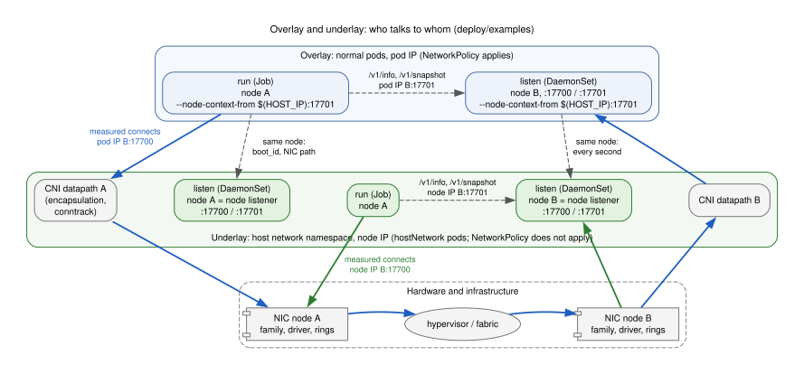

# Running in Kubernetes and OpenShift

[User guide](README.md) · previous: [`run`](04-run.md) · next: [Troubleshooting](06-troubleshooting.md)

For a test series use the [example manifests](#example-manifests); for a quick
check the [ad hoc patterns](#quick-ad-hoc-runs-without-manifests) work with plain
`kubectl` / `oc`.



- **Overlay** (top): `run` connects to the pod IP of the `listen` pod on node B. The
  connect passes the CNI datapath of both nodes (encapsulation, connection
  tracking), the NICs and the fabric.
- **Underlay** (bottom): `run` with `hostNetwork` connects to node B's IP. Only NIC,
  driver, hypervisor and fabric are on the path.
- **Control requests** (dashed): `run` reads every target's control port. An overlay
  pod reads its NIC path from the underlay `listen` on **its own node** (the node
  listener, `$(HOST_IP):17701`); that request never leaves the node.

## Which pod for which path

| Path | Pod | Notes |
|---|---|---|
| overlay | a normal pod | runs under the default restricted policy; random UID is fine |
| underlay | a pod with `hostNetwork: true` | OpenShift: SCC `hostnetwork-v2` for its service account; Kubernetes: a namespace with Pod Security level `privileged`, or `kubectl debug node/<node>` |

Give the measuring pod a **CPU limit of at least 500m** (`run` refuses less) and run
`selftest` in the same kind of pod first.

## Quick ad hoc runs without manifests

The static binary runs in any pod. Copy it in and run it:

```sh
# overlay: a short-lived pod with a CPU limit, under the restricted SCC
oc run nm --rm -it --image=<any image with a shell> \
  --override-type=strategic \
  --overrides='{"metadata":{"annotations":{"openshift.io/required-scc":"restricted-v2"}},
    "spec":{"containers":[{"name":"nm","resources":{"limits":{"cpu":"1","memory":"256Mi"}}}]}}' \
  --command -- /bin/bash
oc cp k8s-netmeasure nm:/tmp/k8s-netmeasure
```

- `--override-type=strategic` merges the container by name, so `--image` stays; with
  the default merge type the containers list would be replaced.
- When an admin creates the pod, OpenShift otherwise picks an SCC the admin may use
  (often `anyuid`); `openshift.io/required-scc` enforces the one a real measuring pod
  gets.
- Write result files to `/tmp` or a volume: the working directory is usually not
  writable for the random UID.

```sh
# underlay: a debug pod on the node (hostNetwork, privileged)
oc debug node/<node>
```

In a debug pod the node's root file system is under `/host`; a file copied into the
debug pod with `oc cp` lands in the pod, not on the host. The debug pod is
privileged and runs as root: fine for `selftest` and `probe`, but its CPU and cgroup
values are not those of a normal measuring pod.

## Example manifests

[`deploy/examples/`](../../deploy/examples/README.md) has two kustomize directories;
apply them with `oc apply -k` (or `kubectl apply -k`). They create no Service, Route
or Ingress.

| Directory | Creates |
|---|---|
| `listen/` | namespace `netmeasure`; service account `netmeasure-underlay` (OpenShift: may use SCC `hostnetwork-v2`); `listen` DaemonSets for underlay (hostNetwork) and overlay; a NetworkPolicy that lets only overlay `run` pods reach the overlay `listen` pods |
| `run/` | a volume for result files; one `run` Job, overlay or underlay; a pod to fetch the files |

1. Set the image in both `kustomization.yaml` (`newTag: SET-ME`; CI publishes
   `sha-<12-char commit>` and release versions; a digest is better).
2. Check, then apply the listen side:
   ```sh
   oc apply -k deploy/examples/listen --dry-run=server
   oc apply -k deploy/examples/listen
   oc -n netmeasure get pods -o wide
   ```
   The overlay pods restart until the underlay pod on their node is ready: they
   refuse to start without their node listener.
3. Take the NIC inventory: `/v1/context` of every underlay `listen` lists its node's
   NIC family, driver and rings. Choose source and target nodes from it.
   ```sh
   for ip in $(oc get nodes -l node-role.kubernetes.io/worker -o jsonpath='{.items[*].status.addresses[?(@.type=="InternalIP")].address}'); do
     curl -s "http://$ip:17701/v1/context" | jq -c '{node: .node_name.value, nic: .nic}'
   done
   ```
4. In `run/run-overlay.yaml` (or `run-underlay.yaml`) set the source node
   (`SOURCE-NODE`), the targets (overlay: pod IPs of the overlay `listen` pods;
   underlay: node IPs) and `PHASE`, enable the Job in `run/kustomization.yaml` and
   apply it:
   ```sh
   oc apply -k deploy/examples/run
   oc -n netmeasure logs -f job/netmeasure-run-overlay
   ```
5. Fetch the result: enable `results-reader.yaml`, apply again, then
   ```sh
   oc -n netmeasure exec netmeasure-results-reader -- ls /results
   oc -n netmeasure cp netmeasure-results-reader:/results ./results
   ```
6. For the next run delete the Job first (its pod template is immutable), change
   `PHASE`, apply again. Delete the namespace when the test series is over.

The Jobs use requests = limits (1 CPU, Guaranteed QoS), `backoffLimit: 0` (a
measurement is never retried automatically) and `terminationGracePeriodSeconds: 30`.
A ReadWriteOnce volume serialises Jobs on different source nodes; use ReadWriteMany
or one claim per Job for concurrent runs.

## Overlay with a node listener

For overlay measurements run two `listen` on every node involved: one with
`hostNetwork` (the node listener, port 17700/17701 on the node IP) and one in a normal
pod. The overlay `listen` and the overlay `run` take
`--node-context-from <node-ip>:17701`, so results carry the NIC path of the node.
Pass the node IP via the Downward API (`status.hostIP`). Two `listen` with
`hostNetwork` on one node would collide on the ports; one per node is enough.

## Shutdown and probes for a `run` Job

Kubernetes sends SIGTERM and kills the pod after `terminationGracePeriodSeconds`
(default 30 s). `run` needs up to `--shutdown-deadline` + `--timeout` + the time to
write the file, so set

```
terminationGracePeriodSeconds ≥ shutdown-deadline + timeout + 10 s   (defaults: 25 s)
```

A long `run` Job that should have startup and liveness probes sets
`--control-port 17702`; `/live` turns 503 only if the measuring or the main thread
stalls, never because of the network.

## Node name and context

Pass the node name through the Downward API so result files name nodes, not IPs:

```yaml
env:
  - name: NODE_NAME
    valueFrom: { fieldRef: { fieldPath: spec.nodeName } }
```

`listen` and `run` use `$NODE_NAME` unless `--node-name` is given. Zone and instance
type are declared with `--zone` / `--instance-type`. They are node labels
(`topology.kubernetes.io/zone`, `node.kubernetes.io/instance-type`), which the
Downward API cannot read, and Phase 1 reads no API; Phase 2 reads them from the API.

## Security

> [!WARNING]
> **`listen` has only minimal protection. Never expose it to the internet.**

- Neither port has authentication, TLS, rate limiting or an allowlist.
- Anyone who reaches the measured port can fill its accept queue and so falsify
  measurements (they show up as `listener_drops`, but the run is lost).
- The control port discloses node details: kernel, boot id, CPU, NIC drivers and ring
  sizes, cgroup limits.
- With `hostNetwork`, NetworkPolicy does not apply, and the ports are open on the
  node address. Cloud security groups of worker nodes often allow all ingress by
  default; check them.

Therefore:

- run `listen` only inside the cluster network and only for the duration of a test
  series;
- restrict access: NetworkPolicy for overlay pods, node firewall or security groups
  for `hostNetwork` pods;
- never create a `LoadBalancer` or `NodePort` Service, Route or Ingress for it;
- `oc port-forward` needs `--control-bind 0.0.0.0`; use it only temporarily.

## Other managed Kubernetes services

Nothing in the tool is OpenShift-specific: it uses Linux system calls, `/proc`, `/sys`
and TCP. On another distribution, run `selftest` first on every node type: kernel
fields and counters differ between kernels, and the node's cgroup version, CPU
architecture (x86_64 builds only) and CNI matter.
