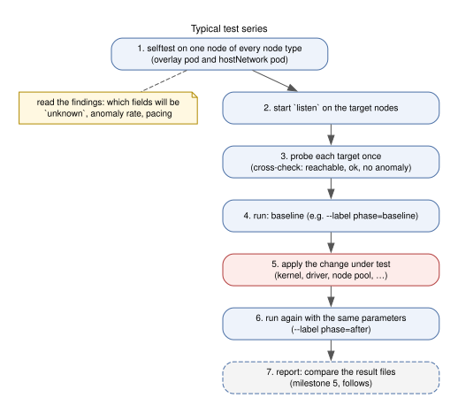

# k8s-netmeasure user guide

How to use `k8s-netmeasure` to measure TCP connect latency between nodes of a
Kubernetes or OpenShift cluster, reproducibly enough to compare node types, NIC
families, kernels or drivers. The design and its reasoning are in
[docs/design](../design/2026-11-13_phase1-design/README.md); this guide covers usage.

**State:** this guide describes what is built today. `selftest`, `probe`, `listen` and
`run` are usable, including `--node-context-from` (NIC context for overlay pods).
Still missing: example manifests and `report` (comparison of result files).
Those parts are marked *follows*.

> [!WARNING]
> **`listen` has only minimal protection. Never expose it to the internet.** See
> [Running in Kubernetes and OpenShift](05-kubernetes-openshift.md#security).

## Contents

1. [Concepts](01-concepts.md): what is measured, paths, loopback control, cycles,
   validity
2. [`selftest` and `probe`](02-selftest-and-probe.md): check a node, cross-check a path
3. [`listen`](03-listen.md): the measurement target
4. [`run`](04-run.md): the measurement and its result file
5. [Running in Kubernetes and OpenShift](05-kubernetes-openshift.md): pods,
   `hostNetwork`, permissions, security
6. [Troubleshooting](06-troubleshooting.md): exit codes, invalid cycles, common errors
7. [Diagrams](diagrams/README.md): sources and how to render them

## Five-minute start



On two machines, or two pods, that can reach each other (`10.0.0.5` is the target):

```sh
# 1. Is this kernel suitable? About 10 s, needs no privileges.
k8s-netmeasure selftest --output selftest.json

# 2. On the target: accept connections on 17700, control port on 17701.
k8s-netmeasure listen

# 3. On the source: one quick cross-check of the path.
k8s-netmeasure probe --target 10.0.0.5:17700 --count 5

# 4. On the source: the measurement (about 56 s at the defaults).
k8s-netmeasure run --target 10.0.0.5:17700 --output baseline.json --label phase=baseline
echo "exit $?"   # 0: every cycle valid, 4: at least one invalid
```

Every flag can also be given as an environment variable `K8S_NETMEASURE_<FLAG>`, e.g.
`--samples` → `K8S_NETMEASURE_SAMPLES`. Setting the same parameter both ways, an
unknown `K8S_NETMEASURE_*` variable or an empty one is an error (exit 2). Logs are
JSON lines on stderr; `--log-level debug` adds detail.

## Getting the binary

| Build | Where | Runs on |
|---|---|---|
| Container image | `ghcr.io/git001/k8s-netmeasure-rs`, signed, with SBOM | the image itself (UBI 10 minimal) |
| Static binary (`x86_64-unknown-linux-musl`) | release asset, or `cargo build --release --target x86_64-unknown-linux-musl` | any x86_64 Linux, any pod (`oc cp` / `kubectl cp`) |
| Dynamic binary (`x86_64-unknown-linux-gnu`) | `cargo build --release` | hosts with glibc ≥ 2.34 |

`k8s-netmeasure --version` ends with `static` or `dynamic`; result files record the
same.
